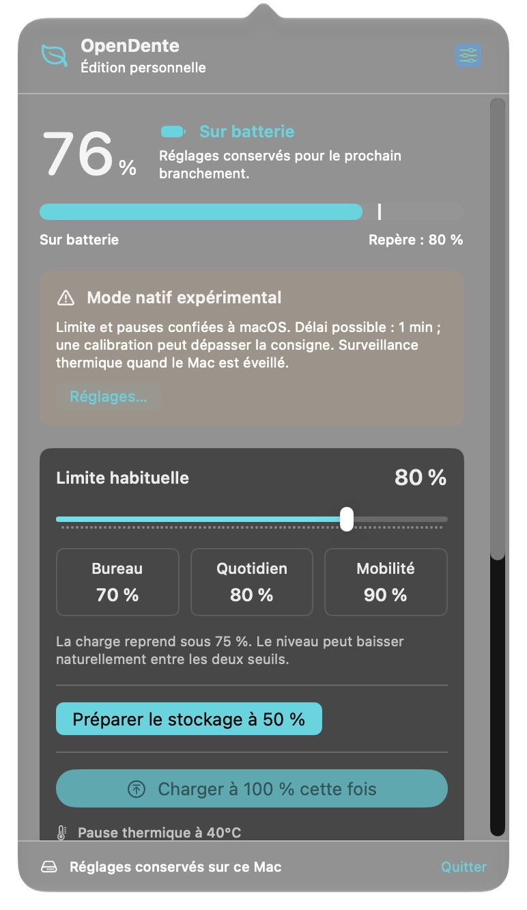
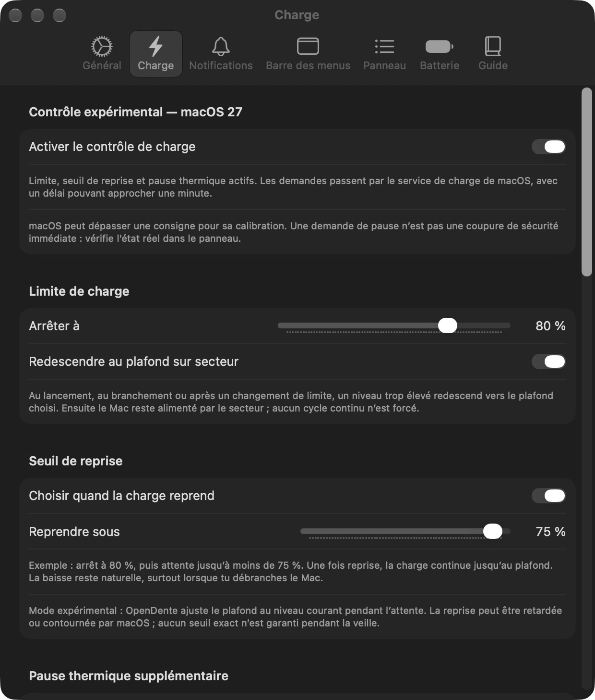
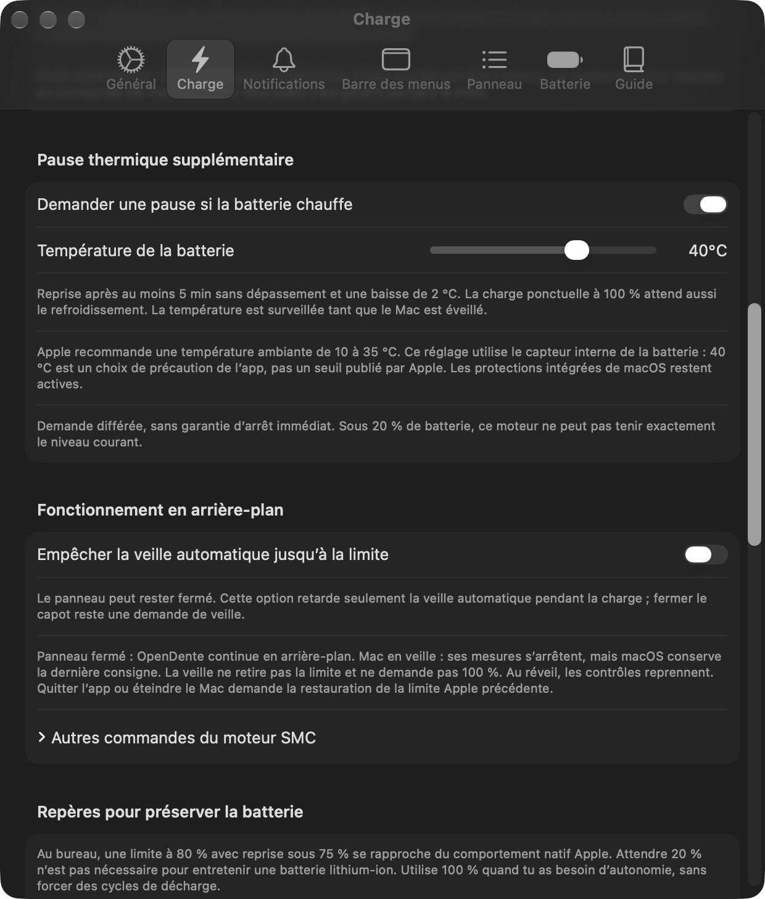
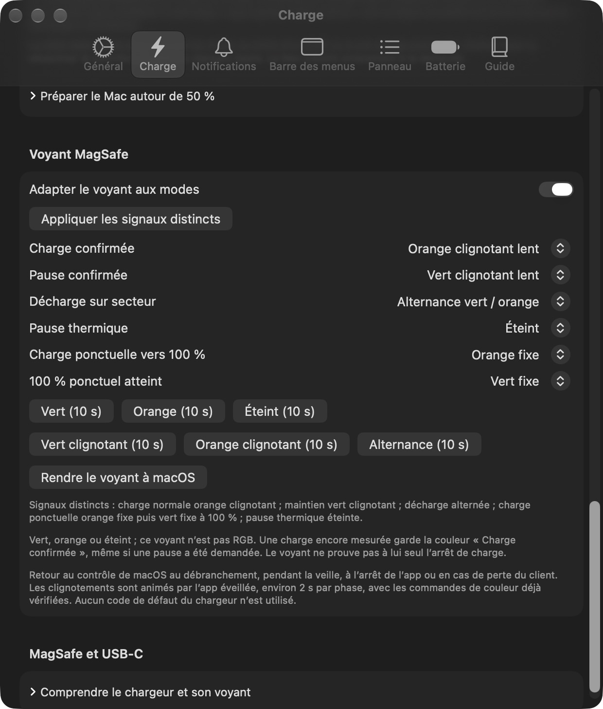
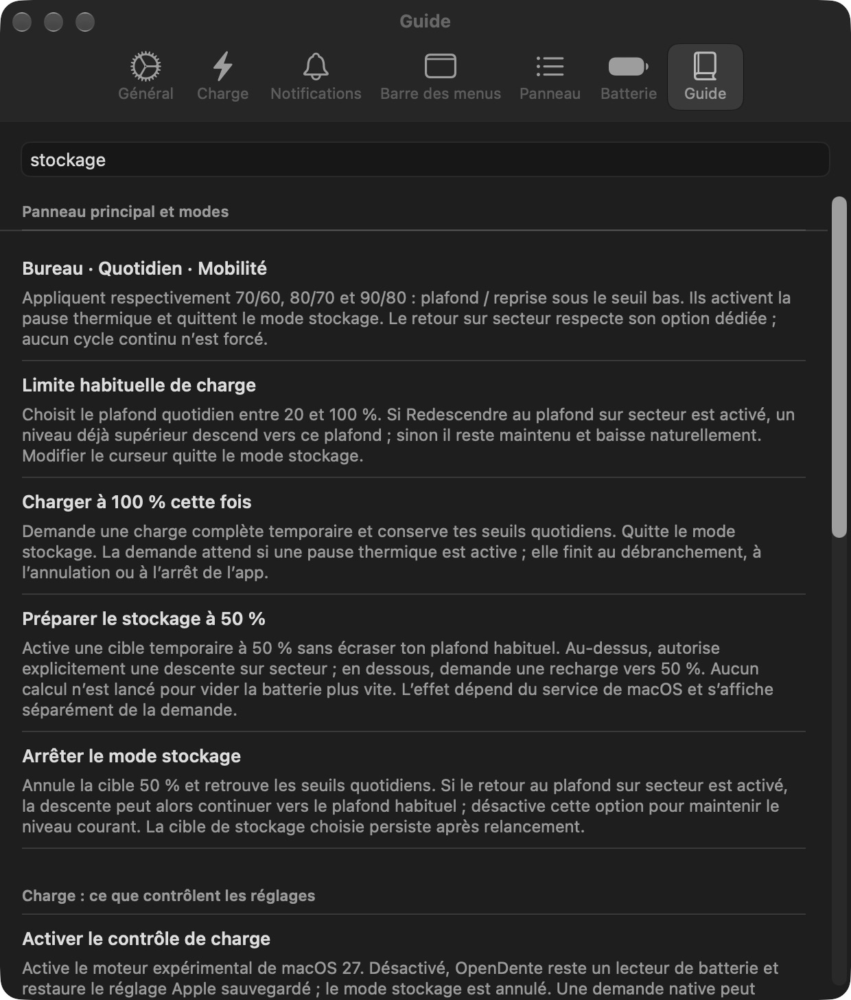

<div align="center">

# OpenDente · Édition personnelle

**Une gestion native de la batterie, au quotidien sur Mac.**

Plafond, seuil de reprise, modes ponctuels et état réel de la charge — dans la barre des menus.

[English](README.md) · [Français](README.fr.md)


</div>

OpenDente personnel est un fork communautaire de [killerk3emstar/OpenDente](https://github.com/killerk3emstar/OpenDente), développé par [JulienEsbt](https://github.com/JulienEsbt). Il conserve l’application SwiftUI d’origine et ajoute une interface française, des profils quotidiens, un mode de stockage, des signaux MagSafe et un moteur natif macOS expérimental pour un Mac qui n’expose plus les anciennes clés SMC de charge.

<p align="center">
  
  &nbsp;
  
</p>
<p align="center"><sub>Captures réelles de l’application installée. L’interface est actuellement en français ; ce README existe dans les deux langues.</sub></p>

> [!IMPORTANT]
> **Projet expérimental, testé sur une seule configuration matérielle.** Le moteur natif utilise des interfaces privées Apple et a été essayé sur un MacBook Air M3 sous macOS 27.2. Cela ne garantit ni une compatibilité universelle ni une coupure thermique instantanée. Le build actuel est signé localement et n’est pas notarifié. Lire les [limites de compatibilité](#compatibilité-et-limites) avant d’activer le contrôle de charge.

## Ce que l’on peut faire

| Mode ou réglage | Comportement quotidien |
|---|---|
| **Limite de charge** | Choisir son plafond. Le moteur natif accepte 20–100 % ; les valeurs sous la plage publique Apple de 80–100 % restent expérimentales. |
| **Seuil de reprise** | Attendre une baisse naturelle sous le seuil inférieur, puis recharger jusqu’au plafond. Aucun cycle répété de décharge n’est imposé. |
| **Retour au plafond** | Autoriser une batterie déjà trop chargée à redescendre vers le plafond sur secteur, puis passer au maintien. |
| **Charger à 100 % cette fois** | Demander ponctuellement une charge complète sans remplacer les seuils quotidiens. La pause thermique garde sa priorité. |
| **Préparer le stockage à 50 %** | Utiliser une cible temporaire séparée : décharge vers 50 % au-dessus, recharge vers 50 % en dessous. L’extinction reste manuelle. |
| **Pause thermique supplémentaire** | Demander une pause au-dessus de la température choisie. Reprendre après une baisse de 2 °C et au moins cinq minutes sans dépassement. |
| **Signaux MagSafe** | Choisir couleurs fixes, clignotements lents ou alternance pour la charge, le maintien, la décharge, la chaleur et la charge ponctuelle. |
| **Arrière-plan discret** | Démarrer à la connexion sans ouvrir de fenêtre. Cliquer sur l’icône au besoin ; fermer une fenêtre laisse l’app active. |

Température, capacité, cycles, puissances, courant et informations du chargeur restent consultables. L’app propose aussi un schéma simple des flux d’énergie, des notifications configurables, un guide hors ligne avec recherche et un export local de diagnostic. Les mesures absentes ne sont pas inventées.

## Voir les réglages

<details>
<summary><strong>Pause thermique, signaux MagSafe et guide intégré</strong></summary>

<p align="center">
  
  
</p>
<p align="center">
  
</p>

Les captures des fenêtres de l’app ne sont pas retouchées. Leur version et leur périmètre figurent dans les [notes de capture](docs/images/README.md).

</details>

## Compatibilité et limites

| Sujet | Périmètre actuel |
|---|---|
| Cible de compilation | macOS 14 ou ultérieur ; le projet vise les Mac Apple Silicon. L’exécution sur Intel n’est pas testée. |
| Validation matérielle | MacBook Air M3, 16 Go, macOS 27.2 ; alimentation MagSafe. |
| Moteur SMC d’origine | Conservé pour les machines qui exposent les clés compatibles ; aucune nouvelle validation générale de ces modèles n’est revendiquée. |
| Moteur natif | Interfaces PowerUI privées, détectées à l’exécution. Un réglage ne peut pas rendre disponible une commande absente. |
| USB-C Power Delivery | La régulation vise la batterie interne indépendamment du port ; aucun essai USB-C physique n’est revendiqué. |
| Distribution | Compilation depuis les sources et signature locale ; aucun installateur public notarifié n’est fourni ici. |

**Une demande et son effet mesuré sont distincts.** Une commande native peut prendre environ une minute. macOS peut ponctuellement monter à 100 % pour maintenir son estimation de charge. Une pause demandée ou un voyant vert ne prouvent pas à eux seuls l’arrêt du courant de batterie.

Pendant la veille, macOS conserve la dernière cible native ; l’app ne mesure pas la température en continu et n’anime pas le voyant. Les contrôles reprennent au réveil. La prévention de veille automatique est facultative et ne bloque ni la veille manuelle ni celle du capot.

Quitter demande au service de restaurer les réglages Apple sauvegardés et le voyant système. Pour un repli système à 80 %, quitter OpenDente, régler la limite Apple à 80 % avec recharge optimisée, puis relancer l’app. **Le réglage Apple et ce moteur natif utilisent le même mécanisme, pas deux plafonds indépendants.** Un essai de veille ne constitue pas un essai après extinction complète.

Le défaut de 40 °C utilise le capteur interne de la batterie : c’est une précaution de l’app, pas un seuil de capteur prescrit par Apple. La pause supplémentaire est différée ; les protections matérielles et système d’Apple restent actives.

## Compiler et lancer

Il faut **Xcode complet**, **XcodeGen**, et une identité de signature avec certificat et clé privée pour l’app et le service. Le service refuse une simple signature ad hoc. Utiliser sa propre identité ; aucune clé privée n’est fournie dans le dépôt.

```sh
git clone https://github.com/JulienEsbt/OpenDente.git
cd OpenDente
git switch feature/personal-battery-care
brew install xcodegen
export DEVELOPER_DIR=/Applications/Xcode.app/Contents/Developer

bash scripts/build-local.sh "Apple Development: VOTRE NOM (IDENTIFIANT DU CERTIFICAT)" "TEAM_ID"
```

La commande ci-dessus sélectionne cette édition sur `feature/personal-battery-care`. Après sa fusion, `main` pourra être utilisé à la place.

Le script génère le projet Xcode, exécute les tests natifs, produit une app Debug signée et vérifie que l’app et son service utilisent le même certificat. Il ne lance **pas** l’app et n’enregistre **pas** son service privilégié.

1. Copier `build/DerivedData/Build/Products/Debug/OpenDente.app` dans **Applications**. Conserver une seule copie installée.
2. L’ouvrir depuis Applications, puis cliquer sur son icône dans la barre des menus.
3. Dans **Général**, vérifier l’état du service et activer **Ouvrir à la connexion** pour le démarrage discret. macOS peut demander une validation locale du service signé.
4. Dans **Charge**, vérifier les seuils et activer explicitement le moteur natif s’il est proposé. Utiliser une seule app active de contrôle de batterie.

Pour une Release, ouvrir le projet généré dans Xcode, sélectionner son équipe de signature pour les deux cibles et compiler en configuration Release. Les [notes de compilation et signature](README-PERSONAL.md) détaillent l’implémentation et le parcours de validation locale.

## Une validation vérifiable

**Version 0.6.2 : 380 tests XCTest natifs réussis sur arm64.** Le service inchangé dispose de 36 scénarios complémentaires de récupération, cycle de vie et watchdog consignés dans le bilan. La Release universelle compile pour arm64 et x86_64 ; seule l’exécution arm64 est revendiquée.

Les essais physiques comprennent l’arrêt et la reprise de charge sur une petite plage, la descente vers une cible native inférieure sur MagSafe, la restauration à la fermeture, la relance, la veille/réveil et la confirmation visuelle des couleurs et motifs MagSafe par le propriétaire. Un cycle complet 80→75→80, la chauffe volontaire, l’USB-C physique et une extinction complète ne sont pas présentés comme réalisés.

```sh
# Tests natifs : frontières matérielles inertes, aucun enregistrement du service
xcodegen generate
xcodebuild test -project OpenDente.xcodeproj -scheme OpenDente \
  -destination 'platform=macOS,arch=arm64' -derivedDataPath build/DerivedData \
  CODE_SIGNING_ALLOWED=NO

# Scénarios complémentaires et contrôle natif des types du service
python3 tests/helper/run_tests.py
```

Ces nombres sont des résultats locaux, pas un badge de CI ni une preuve de supériorité sur une autre app. [Bilan complet](VALIDATION.md) · [Portée des tests du service](tests/helper/README.md)

## Architecture

```text
Application SwiftUI dans la barre des menus
  ├─ BatteryService : mesures IOKit / IORegistry / SMC
  ├─ ChargingManager : seuils, intentions temporaires et état observé
  └─ XPC authentifié par certificat
       └─ Service privilégié
            ├─ Contrôle SMC d’origine, s’il est disponible
            ├─ Cible native PowerUI expérimentale
            └─ Journal de récupération et watchdog
```

L’app lit et présente les mesures ; le service signé exécute les opérations privilégiées. Il vérifie l’identifiant de l’app et le certificat de signature identique au sien. Les modifications restrictives sont journalisées avant écriture ; une restauration échouée conserve l’état nécessaire à une nouvelle tentative.

Aucune télémétrie, analytique, compte ou infrastructure de mise à jour n’est ajouté à l’app. Les diagnostics sont locaux et facultatifs ; relire les identifiants et journaux avant de publier un rapport.

## AlDente, Apple et les suites possibles

OpenDente couvre déjà les commandes quotidiennes : plafond, reprise, retour au plafond, charge ponctuelle complète, pause thermique, voyant et mesures. Il n’a pas la planification, l’intégration Raccourcis ni un parcours multiutilisateur validé d’AlDente. Les mécanismes et la veille diffèrent : des noms de fonctions similaires ne prouvent pas une équivalence.

Les suites les plus utiles sont **des actions Raccourcis**, **une planification facultative** et **des essais sur davantage de machines et de sessions**. La calibration forcée par décharge profonde mensuelle n’est pas ajoutée comme entretien courant. La recharge occasionnelle à 100 % décidée par macOS pour sa jauge est un mécanisme distinct.

[Comparatif et priorités](COMPARATIF.md) · [Comparison in English](docs/FEATURE-COMPARISON.md) · [Fonctions publiées d’AlDente](https://apphousekitchen.com/fr/aldente/fonctionnalites/)

Pour le contexte batterie : [limite Apple](https://support.apple.com/en-us/102338), [cycles lithium-ion](https://www.apple.com/batteries/why-lithium-ion/) et [conservation](https://www.apple.com/batteries/maximizing-performance/). Aucun gain chiffré de durée de vie n’est promis.

## Contribuer et crédits

Compiler et tester une modification ciblée, préciser le Mac et la version de macOS, et distinguer les effets matériels observés des tests simulés. Pour un problème de compatibilité, joindre le moteur actif et les mesures ; masquer les identifiants des diagnostics avant partage. Voir la [spécification](SPEC-PERSONAL.md), le [guide](GUIDE-UTILISATION.md) et le [journal des changements](CHANGELOG-PERSONAL.md).

Ce projet reste un fork de **[killerk3emstar/OpenDente](https://github.com/killerk3emstar/OpenDente)**. La limite, le Sailing Mode, le contrôle SMC, les mesures, notifications et l’architecture de base viennent de ce projet. L’historique, la licence et les crédits sont conservés ; le [README amont historique](docs/UPSTREAM-README.md) reste consultable.

Autres remerciements : [Battery-Toolkit](https://github.com/mhaeuser/Battery-Toolkit), [SMCKit](https://github.com/beltex/SMCKit), [actuallymentor/battery](https://github.com/actuallymentor/battery), [batt](https://github.com/charlie0129/batt) et [Ampere / AZ Code Lab](https://github.com/az-code-lab/ampere) pour le mécanisme natif adapté.

**GPL-3.0.** Voir [LICENSE](LICENSE) et les [notices tierces](THIRD-PARTY-NOTICES.md), dont l’attribution MIT du code adapté d’Ampere. Ce projet n’est affilié ni à Apple ni à AppHouseKitchen.
