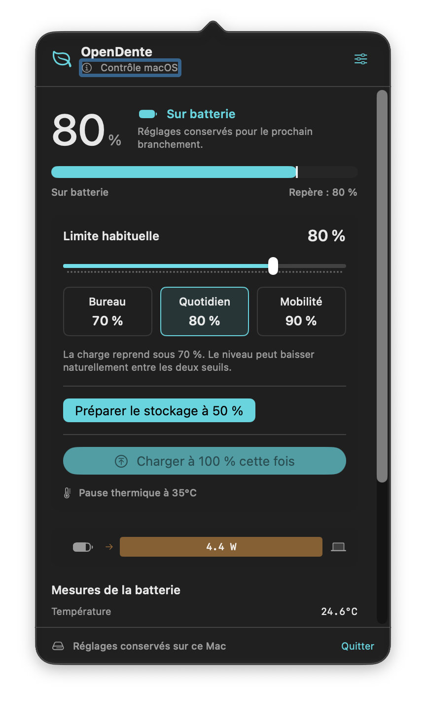
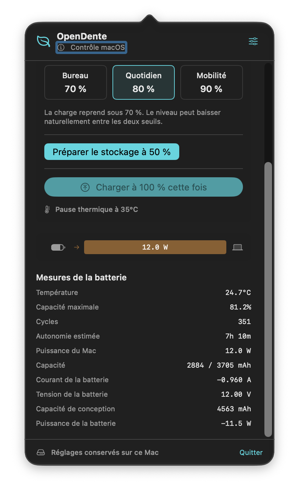
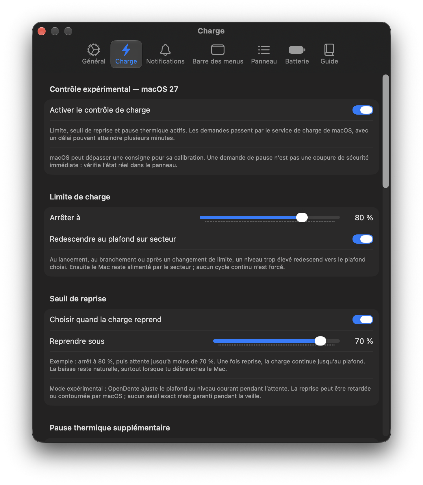
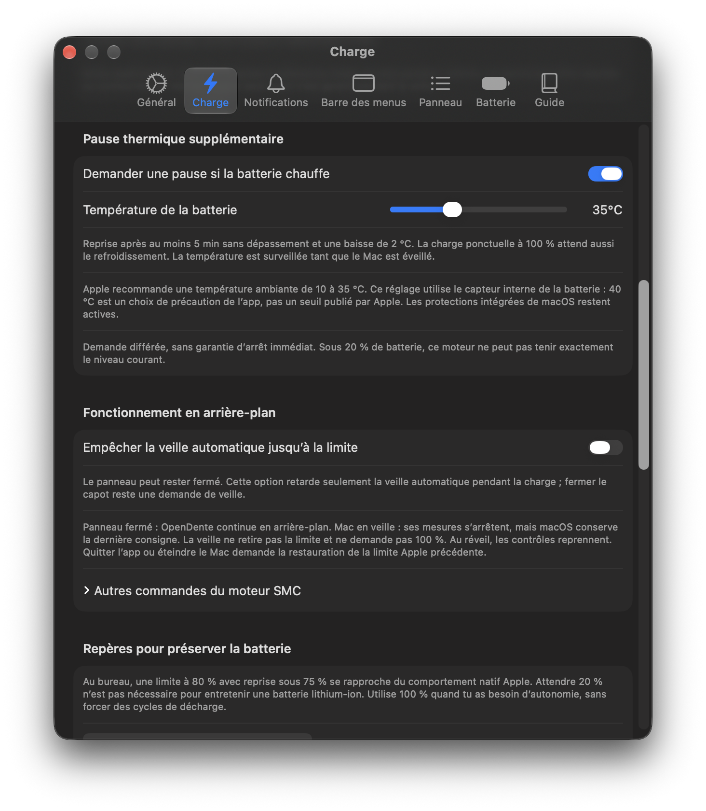
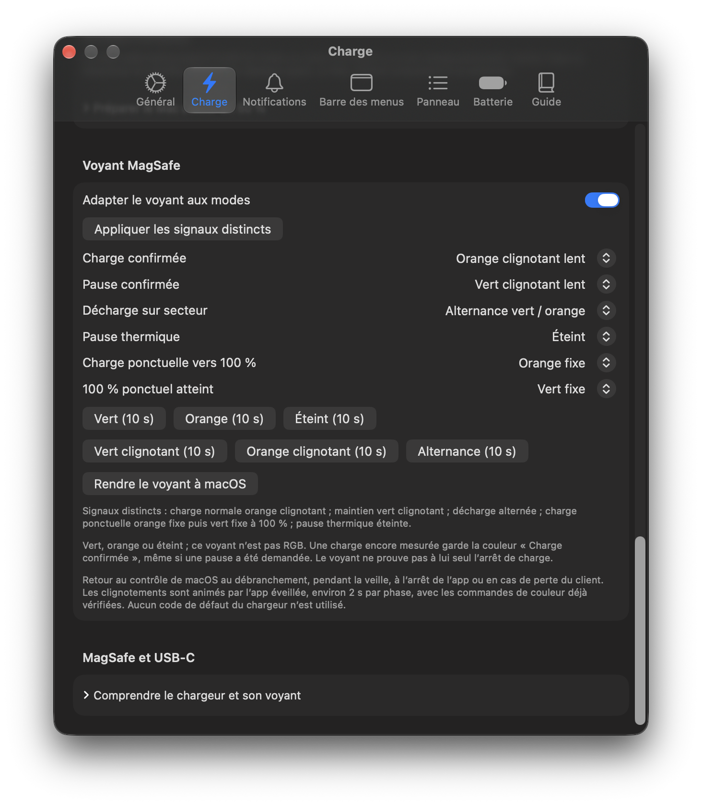
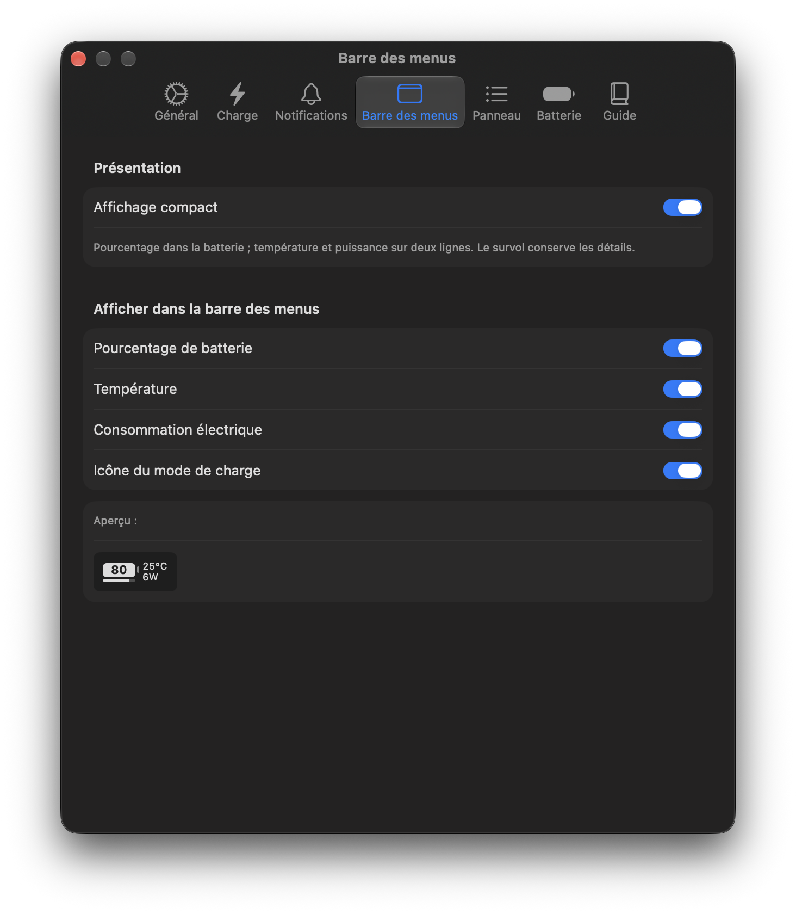
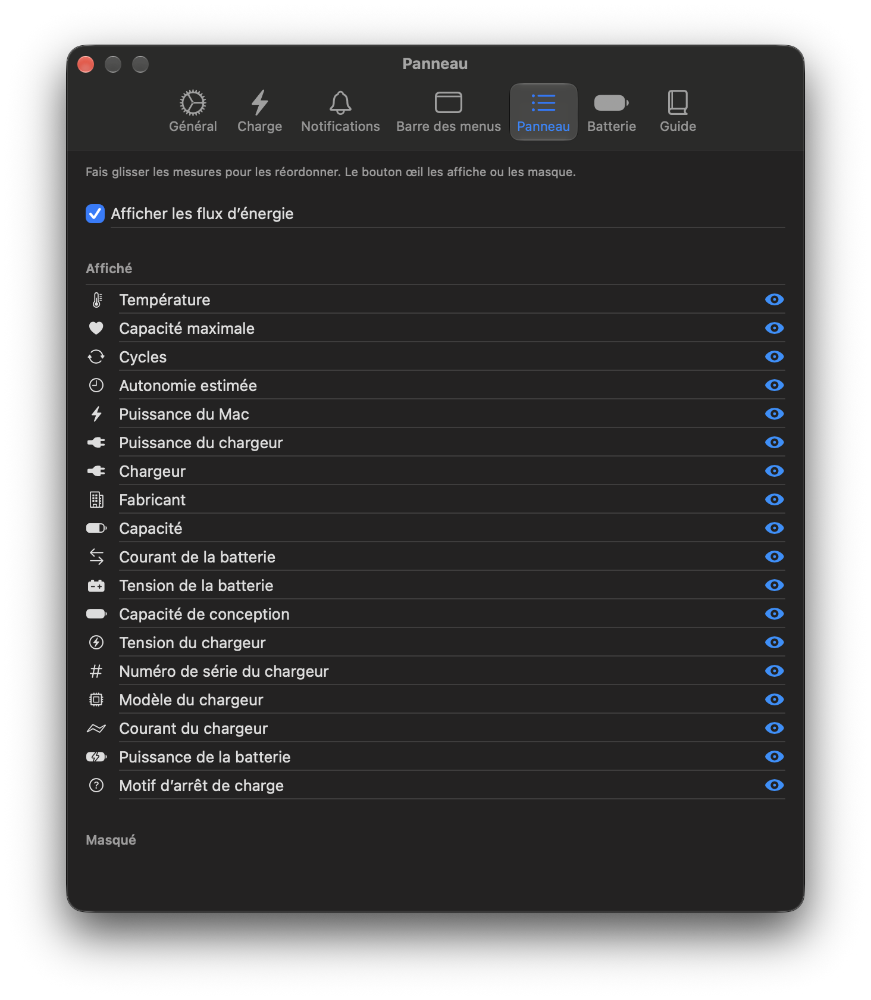
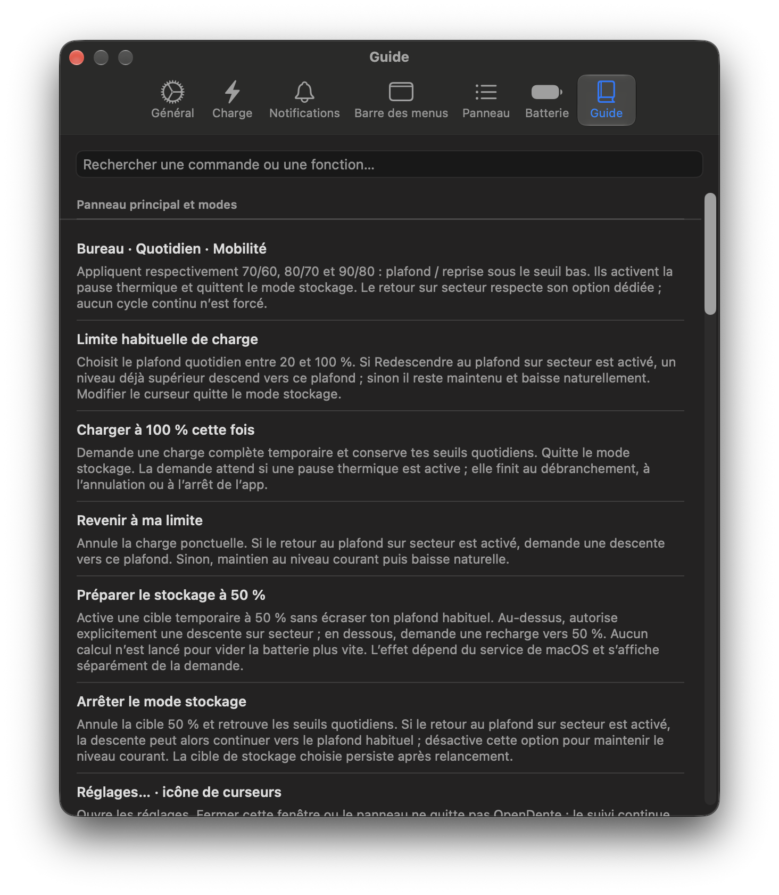

<div align="center">

# OpenDente · Personal Edition

**Battery care, at home in your Mac’s menu bar.**

Set a charge limit. See what the battery is doing. Keep your everyday settings in the background.

**English** · [Français](README.fr.md)

[](#compatibility) [](project.yml) [](CHANGELOG-PERSONAL.md) [](LICENSE)

[Features](#features) · [Screenshots](#screenshots) · [Build & run](#build-and-run) · [Documentation](#documentation)

</div>

A native SwiftUI battery utility for macOS, maintained by [JulienEsbt](https://github.com/JulienEsbt) as a fork of [killerk3emstar/OpenDente](https://github.com/killerk3emstar/OpenDente). This edition adds French and English interfaces, everyday profiles, storage preparation, compact status and an experimental native charge backend, while preserving the original project’s history and credits.

<p align="center">
  <a href="docs/images/panel.png"></a>
  <a href="docs/images/measurements.png"></a>
</p>
<p align="center"><sub>Actual OpenDente 0.7.2 screenshots. French interface shown; 0.8.0 also includes English and improved light-mode colors. Click an image for full resolution.</sub></p>

> [!IMPORTANT]
> **The native charge backend is experimental.** It uses private Apple interfaces and has been tested on a MacBook Air M3 running macOS 27.2. Compatibility and response times vary. This repository provides source code for local signing, with no notarized public installer. Review the [limitations](#compatibility) before enabling charge control.

## Features

| Control | What it does |
|---|---|
| **Daily limit & profiles** | Choose a ceiling and switch between Bureau, Quotidien and Mobilité profiles. The native backend accepts requests from 20–100%; targets below Apple’s public 80–100% range remain experimental. |
| **Resume threshold** | Resume charging after a natural drop below a lower threshold, then continue to the ceiling. No repeated discharge cycles are forced. |
| **Return to the ceiling** | Optionally discharge an already high battery level toward your daily ceiling while plugged in, then hold there. |
| **One-off full charge** | Temporarily request 100% without replacing your daily settings. Thermal pauses retain priority. |
| **Storage preparation** | Use a separate 50% target, charging or discharging toward it as needed. Daily settings are retained; unplug and shut down manually when ready. |
| **Additional thermal pause** | Request a pause at a configurable internal battery temperature. Resume after cooling by 2°C and at least five minutes without exceeding the threshold. |
| **MagSafe signals** | Assign fixed green, orange or off, slow blinking and alternating patterns to charge states. Ten-second previews make each signal easy to check. |
| **Language & appearance** | Follow the Mac language or choose French/English in General. Controls, the offline guide and notifications are translated; colors adapt to light and dark mode. |
| **Quiet background operation** | Launch at login directly into the menu bar. Closing a window keeps the app running; open the panel only when you need it. |

The compact status puts the percentage **inside the battery**, with a separate level track and optional temperature, power and mode indicators. The classic layout remains available. Customize the panel’s measurements, inspect energy flows, choose notifications, search the offline guide or export a local diagnostic report.

## Screenshots

<details>
<summary><strong>Explore charge settings, MagSafe, the compact display and the built-in guide</strong></summary>

<p align="center">
  <a href="docs/images/charge-settings.png"></a>
  <a href="docs/images/thermal-settings.png"></a>
  <br><sub>Charge policy and return to the ceiling · Additional thermal pause</sub>
</p>
<p align="center">
  <a href="docs/images/magsafe-settings.png"></a>
  <a href="docs/images/menu-bar-settings.png"></a>
  <br><sub>MagSafe colors and patterns · Compact menu bar</sub>
</p>
<p align="center">
  <a href="docs/images/panel-settings.png"></a>
  <a href="docs/images/offline-guide.png"></a>
  <br><sub>Choose your measurements · Find help without leaving the app</sub>
</p>

These unmodified captures show example settings: **80/70% and 35°C**. They are customizable choices, not fixed defaults or evidence of a thermal test. The app’s thermal default is 40°C; the recorded everyday validation used 80/75%. See the [capture notes](docs/images/README.md).

</details>

## Compatibility

| Area | Current scope |
|---|---|
| Build target | macOS 14 or later, Swift 6. Universal Release compilation covers arm64 and x86_64; only arm64 execution has been tested. |
| Hardware validation | MacBook Air M3, 16 GB, macOS 27.2. Real charging checks used USB-C Power Delivery and MagSafe. |
| Native backend | Private PowerUI interfaces, detected at runtime, for this Mac where the original SMC charging keys are unavailable. |
| Original SMC backend | Preserved for compatible machines. This fork does not claim fresh validation across those models. |
| Distribution | Build from source and sign locally with your own certificate. The app and privileged helper must use the same signing identity. |

**A requested target is not an immediate hardware cutoff.** Native changes can take several minutes. macOS allows a few percentage points of tolerance and may occasionally charge to 100% to maintain its gauge. See [Apple’s charge-limit documentation](https://support.apple.com/en-us/102338).

During sleep, macOS retains the last native target; OpenDente does not continuously monitor temperature or animate the LED. Controls resume on wake. The app cannot run when the Mac is powered off. Optional idle-sleep prevention does not block manual sleep or lid-close sleep.

On quit, the helper requests restoration of the saved Apple settings and system LED behavior. **The Apple limit and this native backend share the same mechanism**; they are not independent fallbacks. Configure the Apple policy you want restored before enabling the app’s native mode. The 40°C thermal default is an app precaution, not an Apple-prescribed internal sensor threshold or an instantaneous safety cutoff. Apple’s own protections remain in place.

## Build and run

Install and initialize **full Xcode** first; Command Line Tools alone are insufficient. You also need **XcodeGen** and an Apple Development signing identity with its certificate and private key. The helper rejects an ad hoc signature.

```sh
git clone --branch feature/personal-battery-care https://github.com/JulienEsbt/OpenDente.git
cd OpenDente
brew install xcodegen
export DEVELOPER_DIR=/Applications/Xcode.app/Contents/Developer

bash scripts/build-local.sh "Apple Development: YOUR NAME (CERTIFICATE ID)" "TEAM_ID"
```

This edition currently lives on `feature/personal-battery-care`; use `main` after it is merged. Replace the signing placeholders with your own identity. The script generates the Xcode project, runs native tests, builds a signed Debug app and verifies matching app/helper certificates. It does not install or launch the privileged service.

1. Copy `build/DerivedData/Build/Products/Debug/OpenDente.app` into **Applications** and keep one installed copy.
2. Launch it, then click its battery icon in the menu bar.
3. In **General**, choose the interface language, activate the signed service when needed and enable **Launch at login** for quiet login startup. Approve any macOS authorization locally.
4. In **Charging**, review your thresholds and explicitly enable the native backend if offered. Keep only one battery-control app active.

For a Release build, signing details and troubleshooting, see the [local development guide](README-PERSONAL.md).

## Validation

Version **0.8.0 (16)** adds bilingual presentation and adaptive colors; its software checks are recorded in [VALIDATION.md](VALIDATION.md). The latest physical charging validation remains **0.7.2 (15), 26 October 2026**:

| Check | Recorded result |
|---|---|
| Native tests | **389 XCTest cases passed** on arm64. |
| Helper tests | **36 recovery, lifecycle and watchdog scenarios passed**, with simulated hardware boundaries and native Security/XPC type checking. |
| Charging | USB-C hold at 78%; resume at 74% for the 80/75 policy, continued charge after switching supply, then measured stop and hold at 80%. |
| Thermal policy | Physical pause/resume verified with the real sensor and a temporary low threshold, without heating the Mac. This is not a test at an actual hot-battery threshold. |

Physical sleep/wake, relaunch, restoration and MagSafe-pattern evidence is recorded from earlier releases. No new 0.7.2 sleep test or controlled full-shutdown test is claimed; startup on the latest version can be observed at the next normal reboot. Results on one Mac are not universal hardware certification.

[Full validation record](VALIDATION.md) · [Helper-test scope and commands](tests/helper/README.md)

## Documentation

| Start here | Contents |
|---|---|
| [User guide — Français](GUIDE-UTILISATION.md) | Controls, everyday use, storage, sleep and battery-care references. |
| [Development & signing — Français](README-PERSONAL.md) | Xcode setup, local builds and technical details. |
| [Feature comparison — English](docs/FEATURE-COMPARISON.md) / [Français](COMPARATIF.md) | Original OpenDente, this edition, AlDente and possible next steps. |
| [Specification — Français](SPEC-PERSONAL.md) | Intended behavior and constraints. |
| [Language & appearance — English](docs/LOCALIZATION.md) | Language selection, translation resources, adaptive colors and focused checks. |
| [Changelog — Français](CHANGELOG-PERSONAL.md) | Version history. |

For battery-care context, see Apple’s [charge limits](https://support.apple.com/en-us/102338) and [long-term storage guidance](https://www.apple.com/batteries/maximizing-performance/). No particular battery-lifespan gain is promised. Scheduling, Shortcuts integration and a validated multi-user workflow are not included in this edition.

## Architecture and contributing

The SwiftUI app reads measurements through IOKit, IORegistry and SMC, and applies daily policy through `ChargingManager`. A certificate-authenticated XPC connection delegates privileged operations to the helper, which selects the available SMC or native backend. A recovery journal and watchdog support restoration after failures.

No telemetry, analytics, account or update server is added to the app. Diagnostic exports stay local and optional; review hardware identifiers and logs before sharing them publicly.

Contributions should describe the Mac, macOS version, active backend and observed behavior. Keep changes focused, run the relevant native and helper tests, and distinguish simulated checks from physical measurements. Compatibility reports with clear reproduction steps are welcome.

## Credits and license

This project builds on **[killerk3emstar/OpenDente](https://github.com/killerk3emstar/OpenDente)**. Charge limiting, sailing mode, SMC controls, measurements, notifications and the original app architecture come from upstream. The original history, license and credits are preserved, along with the [upstream README](docs/UPSTREAM-README.md).

Additional acknowledgements: [Battery-Toolkit](https://github.com/mhaeuser/Battery-Toolkit), [SMCKit](https://github.com/beltex/SMCKit), [actuallymentor/battery](https://github.com/actuallymentor/battery), [batt](https://github.com/charlie0129/batt), and [Ampere / AZ Code Lab](https://github.com/az-code-lab/ampere) for the adapted native mechanism.

**GPL-3.0.** See [LICENSE](LICENSE) and [third-party notices](THIRD-PARTY-NOTICES.md), including the MIT attribution for the adapted Ampere code. OpenDente Personal is not affiliated with Apple or AppHouseKitchen.
